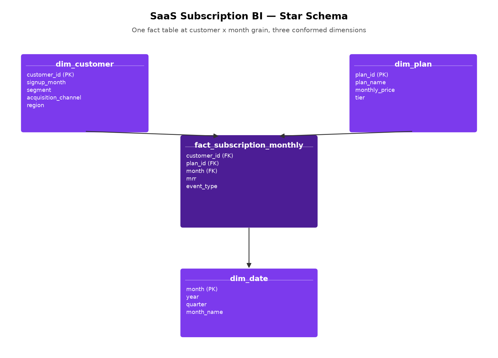
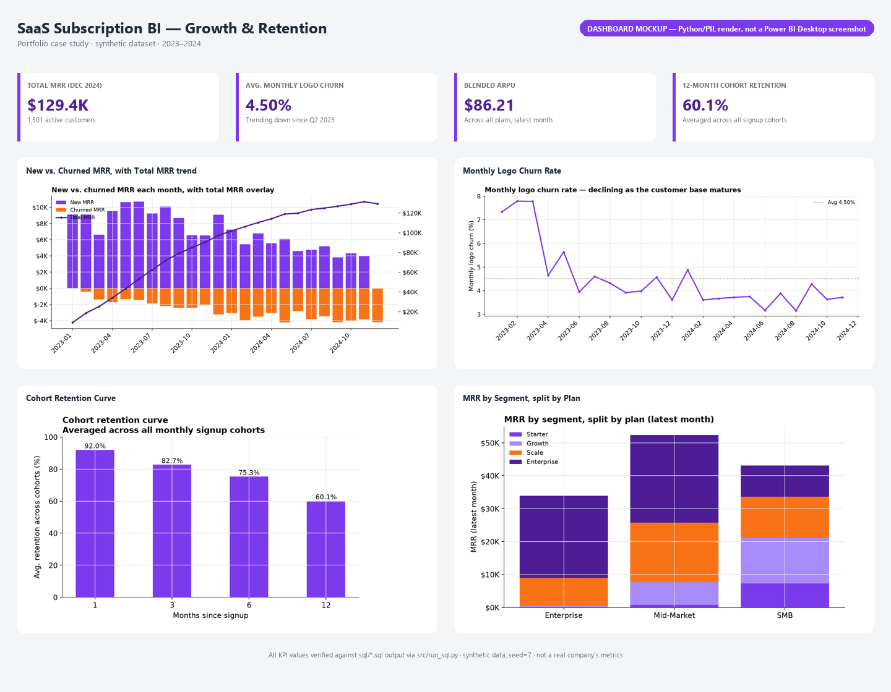

# SaaS Subscription BI — Growth & Retention

A business intelligence case study on a SaaS subscription business: MRR
movement, logo churn, cohort retention, and revenue-per-account, modeled as a
proper star schema with Power BI-native DAX measures — every number
independently verified by executing the equivalent SQL, not hand-typed.

**Status:** complete, reproducible end-to-end · **Data:** synthetic, seeded, clearly labeled (see [Dataset](#dataset))

> **On the Power BI file:** Power BI Desktop was not available in the
> environment this project was built in, so there is no `.pbix` in this repo.
> What *is* here is the real deliverable underneath one: a verified star
> schema (`docs/data_model.md`), Power BI-native DAX measures
> (`dax/measures.dax`) written against that schema and cross-checked against
> executed SQL, and a dashboard layout (`reports/dashboard_mockup.html`,
> rendered to `reports/screenshots/dashboard_overview.png`) built from the
> same verified numbers. Loading `data/` into Power BI Desktop with this
> model and these measures should reproduce the dashboard below exactly.

## Contents

- [Business problem](#business-problem)
- [Business questions](#business-questions)
- [Dataset](#dataset)
- [Data preparation](#data-preparation)
- [Data model](#data-model)
- [DAX / measures](#dax--measures)
- [Dashboard](#dashboard)
- [Key findings](#key-findings)
- [Business recommendations](#business-recommendations)
- [Limitations](#limitations)
- [Reproduction](#reproduction)

## Business problem

A subscription business's health can't be read off a single number — revenue
can grow while churn quietly worsens, or churn can look stable while it's
concentrated in the accounts that matter most. This project builds the model
and measures needed to see MRR growth, churn, and retention together, broken
down by the segments and cohorts that explain *why* they're moving.

## Business questions

1. How much of monthly MRR growth is new business vs. offset by churn?
2. Is logo churn improving or worsening over time?
3. Where does retention actually drop off — month 1, month 6, month 12?
4. Which customer segments and plans carry the most revenue weight?
5. Which acquisition channel brings in the highest-value customers?

## Dataset

The dataset is **synthetic and generated by [`src/generate_data.py`](src/generate_data.py)**
with a fixed seed (`SEED=7`) — it does not describe a real company. It models
a plausible SaaS growth pattern: segment-correlated plan selection, an
early-tenure churn hazard spike (common in real subscription businesses — new
customers churn faster than tenured ones), and gradual maturation of the
customer base. The schema (customer, plan, monthly subscription-state fact)
is the standard shape of a real Stripe/Chargebee/subscription-platform export,
so the model and measures below transfer directly.

| Table | Rows | Grain |
|---|---|---|
| `fact_subscription_monthly` | 27,494 | one row per customer per active month, Jan 2023–Dec 2024 |
| `dim_customer` | 2,500 | one row per customer |
| `dim_plan` | 4 | Starter / Growth / Scale / Enterprise |

## Data preparation

```
generate_data.py  →  CSV (dim_customer, dim_plan, fact_subscription_monthly)
        ↓
   load_model.py   →  SQLite star schema (data/saas_bi.db) + generated dim_date + indexes
        ↓
    sql/*.sql        →  5 queries, each verifying one business question
        ↓
   run_sql.py         →  verified output (source of every number in this README)
build_figures.py / build_dashboard_overview.py → reports/figures, reports/screenshots
```

`dim_date` is generated from the distinct months present in the fact table
(the standard Power Query pattern for a calendar table, done here in pandas)
rather than hand-entered — it's how DAX time intelligence (`DATEADD`,
`Starting Customers (Prev Month)`) becomes possible in the first place.

## Data model

Full detail: [`docs/data_model.md`](docs/data_model.md).



One fact table at customer × month grain, three dimensions, one-to-many
relationships from each dimension into the fact table — the standard Power BI
star schema shape.

## DAX / measures

Full file: [`dax/measures.dax`](dax/measures.dax).

```dax
Total MRR = SUM ( fact_subscription_monthly[mrr] )

Logo Churn Rate % =
DIVIDE ( [Churned Customers], [Starting Customers (Prev Month)] )

ARPU = DIVIDE ( [Total MRR], [Active Customers] )
```

Every measure's file header explains how it was verified: each one's logic
was written as SQL first, executed against the real database
(`src/run_sql.py`), and the DAX is the Power BI-native expression of that
already-checked logic — not an untested guess. The file documents this
per-measure, including the one case (cohort retention) that's better modeled
as a calculated table than a single measure, and why.

## Dashboard



Four KPI cards (Total MRR, churn, ARPU, 12-month retention) plus the four
supporting charts below, all built from the same verified query output.
Interactive HTML version: [`reports/dashboard_mockup.html`](reports/dashboard_mockup.html)
(open it locally — chart images load via relative path).

### 1. New vs. churned MRR is converging
New MRR outpaced churned MRR by a wide margin through most of 2023 (commonly
3–8x, per month); by late 2024 they're much closer together — the business is still growing (Total MRR: $129.4K in Dec
2024, up from $9.1K in the first month) but net-new growth is slowing as the
base matures. See [`sql/01_mrr_trend.sql`](sql/01_mrr_trend.sql).

### 2. Logo churn is trending down
Monthly churn started at 7.3–7.8% in the first three months (the early-tenure
churn hazard in the data), dropped sharply by mid-2023, and has held in a
3.2–4.9% band since — averaging **4.50%** overall.
See [`sql/02_monthly_churn_rate.sql`](sql/02_monthly_churn_rate.sql).

### 3. Retention drops fastest in month 1
Cohort retention averages 92.0% at month 1, 82.7% at month 3, 75.3% at month
6, and 60.1% at month 12 — the steepest single drop (8 points) happens in the
first month, not gradually over the year.
See [`sql/04_cohort_retention.sql`](sql/04_cohort_retention.sql).

### 4. Enterprise-tier accounts concentrate revenue in Mid-Market and Enterprise segments
The Enterprise plan ($249/mo) is the largest single revenue line in both the
Mid-Market segment ($26.6K MRR, 107 accounts) and the Enterprise segment
($24.9K MRR, 100 accounts) — segment name and plan name correlate but aren't
redundant: 10 Enterprise-*segment* customers are still on the Growth *plan*.
See [`sql/03_arpu_by_segment_plan.sql`](sql/03_arpu_by_segment_plan.sql).

### 5. Sales-Led and Partner customers are worth more than Self-Serve
Revenue-to-date per customer: Partner $869.84, Sales-Led $868.23, Self-Serve
$820.43 — a ~6% gap. Normalizing by average tenure (Partner 14.9mo,
Sales-Led 15.4mo, Self-Serve 14.8mo) shows Partner customers actually carry
the highest revenue *per month active* ($58.38 vs. $56.38 Sales-Led vs.
$55.43 Self-Serve) — the gap isn't just tenure, Partner-sourced accounts are
worth more per month too.
See [`sql/05_channel_ltv_proxy.sql`](sql/05_channel_ltv_proxy.sql).

## Key findings

See the five numbered findings above — each ties a specific business
question to the query that answers it and the number that resulted.

## Business recommendations

- **Target the month-1 drop-off, not a generic "improve retention" goal.**
  8 of the 40 points lost between signup and month-12 are lost in month 1
  alone — an onboarding/activation intervention has more leverage here than a
  broad retention campaign.
- **Treat the early-tenure churn hazard as a real cost of new-customer
  acquisition**, not just a revenue-growth input — CAC payback calculations
  should account for the fact that a meaningfully higher share of new
  customers churn in their first 3 months than in steady state.
- **Partner-sourced accounts carry the highest revenue per month active, not
  just the longest tenure** — if this holds on real data, it's worth
  understanding why (plan mix? deal size at signup?) before deciding whether
  to invest further in the Partner channel.

## Limitations

- **Data is synthetic**; figures illustrate method, not real business
  performance. See [Dataset](#dataset).
- **Revenue-to-date is a proxy, not a predictive LTV model** — it's a simple
  realized-average, with no discount rate or survival-curve projection. See
  the note in `dax/measures.dax` under `Revenue To Date Per Customer`.
- **DAX measures are verified by logic, not by execution** — they were
  cross-checked against executed SQL producing the same result, but were not
  themselves run inside Power BI Desktop (unavailable in this build
  environment). Loading `data/` into Power BI with this model should
  reproduce them; that step hasn't been performed.
- **No causal inference** — the segment/channel differences described above
  are associations in one synthetic dataset, not causal claims to act on
  without further testing on real data.

## Reproduction

```bash
pip install -r requirements.txt

python src/generate_data.py             # writes data/*.csv
python src/load_model.py                # builds data/saas_bi.db (star schema)
python src/run_sql.py                   # prints verified output for every query
python src/build_figures.py             # writes reports/figures/*.png
python src/build_schema_diagram.py      # writes reports/figures/00_star_schema.png
python src/build_dashboard_overview.py  # writes reports/screenshots/dashboard_overview.png
```

Everything is seeded (`SEED=7`) — re-running from a clean checkout reproduces
identical data, query output, and figures.

## Technologies

Python · pandas · SQLite (window-function-free, calendar-join churn logic) ·
DAX (Power BI measure language) · matplotlib · Pillow

---

Part of [musab-abukaraki-66](https://github.com/musab-abukaraki-66)'s data &
analytics portfolio.
